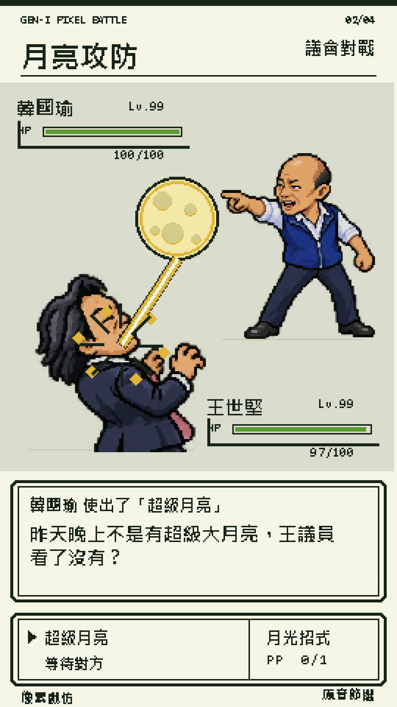

# 網址轉像素對戰動畫

把影片中的精彩對話，製作成寶可夢黃版／Game Boy 風格的直式對戰 Short。

這是一個 Codex skill：Codex 負責選段、核對講者與原音、呼叫 ImageGen 生成人物；附帶的 Python 工具負責素材處理、動作編排、音效、渲染及驗收。



## 使用

安裝後，在 Codex 輸入：

```text
$url-to-pixel-battle https://www.youtube.com/watch?v=影片ID
```

也可以追加指定金句、主角、目標片長或動作要求。已選定這個流程的對話／專案中，之後只貼影片網址即可；其他情境請明確叫用技能。

預設輸出 1080×1920、30 fps 的 MP4，包含原音、繁體中文字幕、HP、招式文字框與音效。人物依來源決定，具備喝水、蓄力、出手、受擊與反應等姿勢；招式可使用水滴、電弧、月光、葉片蟲群、拋球或火焰。

## 安裝

可請 Codex 安裝這個 repository 的 skill，或以 Git 安裝到個人技能目錄。PowerShell 範例：

```powershell
$skillRoot = if ($env:CODEX_HOME) { Join-Path $env:CODEX_HOME 'skills' } else { Join-Path $env:USERPROFILE '.codex/skills' }
git clone https://github.com/weber87na/url-to-pixel-battle.git (Join-Path $skillRoot 'url-to-pixel-battle')
```

若同名資料夾已存在，先確認既有版本與修改，再選擇更新方式。以 Git 安裝的版本可在該目錄執行 `git pull --ff-only` 更新。

## 執行環境

- Codex 與可用的原生 ImageGen 工具。
- Python 3.10+、FFmpeg／FFprobe、yt-dlp。
- Python 套件：`python -m pip install -r scripts/requirements.txt`。
- 可顯示繁體中文的字體。初始化會尋找 Windows 微軟正黑體、Linux Noto CJK 或 macOS PingFang，亦可在工程設定指定字體檔。
- 沒有可用字幕時，才需要 Whisper／Torch 或其他可用轉錄工具；本機繁體轉換另需 OpenCC。

生圖、來源判讀與金句選段由 Codex 執行；單獨執行 Python 腳本不會自動完成人物辨識或 ImageGen。新工程與產生的影片保存於工作目錄，不需要放進技能 repository。

## 流程與文件

1. 下載單支來源影片與可用字幕，檢查實際 FPS、時間碼並抽取參考幀。
2. 核對對話與講者，選出有鋪陳、回應及反擊的片段。
3. 用 ImageGen 製作每人八姿勢透明圖，註冊完整人物範圍與腳底位置。
4. 組合原音、映射字幕、依關鍵詞安排出招和受擊，加入招式特效與音效。
5. 輸出影片並檢查實際編碼畫面、音訊、字幕及完整解碼。

| 文件 | 內容 |
|---|---|
| [SKILL.md](SKILL.md) | 技能入口與製作原則 |
| [執行流程](references/pipeline.md) | 工具需求與 CLI 用法 |
| [工程設定](references/project-schema.md) | 人物、剪輯計畫與時間軸 schema |
| [人物與特效](references/sprites-and-effects.md) | ImageGen 提示詞、動作與特效 |
| [驗收](references/acceptance.md) | 成片檢查項目 |

交付包含 MP4、SRT、人物素材、工程設定與生圖提示詞。此技能不包含社群發布。
